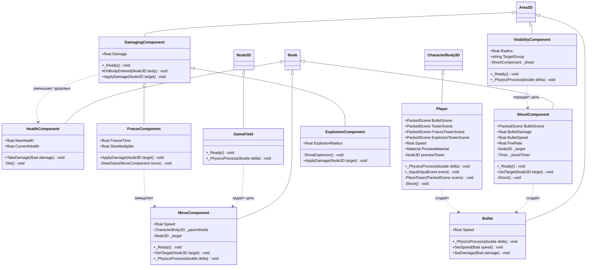

# Лабораторная работа № 3 — Tower Defense

Проект на **Godot 4** и **C#**, демонстрирующий компонентный подход к разработке игры в жанре Tower Defense.

## Описание проекта

Игрок перемещается по трёхмерному полю, стреляет и размещает защитные башни. Башни автоматически обнаруживают противников и атакуют их. В игре есть обычные, взрывные и замораживающие снаряды, а также враги `EnemyTower` и `Crawler`. Цель защиты — сохранить ядро (`Core`): при его уничтожении игра останавливается.

## Управление

| Действие | Клавиша |
| --- | --- |
| Передвижение | W, A, S, D |
| Прицеливание / поворот игрока | Мышь |
| Выстрел | Левая кнопка мыши |
| Обычная башня | 1 |
| Замораживающая башня | 2 |
| Взрывная башня | 3 |

При размещении башни сначала появляется полупрозрачный предварительный просмотр. Повторное нажатие выбранной клавиши подтверждает размещение.

## Структура проекта

```text
lub-3/
├── Components/
│   ├── HealthComponent.cs
│   ├── MoveComponent.cs
│   ├── ShootComponent.cs
│   ├── VisibilityComponent.cs
│   ├── DamagingComponent.cs
│   ├── ExplosionComponent.cs
│   └── FreezeComponent.cs
├── Scripts/
│   ├── Player.cs
│   ├── Bullet.cs
│   └── GameField.cs
├── Scenes/
│   ├── GameField.tscn
│   ├── Player.tscn
│   ├── Core.tscn
│   ├── Tower.tscn
│   ├── FreezeTower.tscn
│   ├── ExplosionTower.tscn
│   ├── EnemyTower.tscn
│   ├── Crawler.tscn
│   ├── Bullet.tscn
│   ├── FreezeBullet.tscn
│   └── ExplosionBullet.tscn
└── README.md
```

## UML-диаграмма классов

Стрелка с пустым треугольником обозначает **наследование**, пунктирная стрелка — **использование другого класса**.



## Назначение классов

| Класс | Назначение и основная логика |
| --- | --- |
| `GameField` | Управляет целями движения врагов: ищет ближайший объект группы `towers` и передаёт его в `MoveComponent` для `EnemyTower` и `Crawler`. |
| `Player` | Обрабатывает управление WASD, поворот к курсору, стрельбу и размещение трёх видов башен с предварительным просмотром. |
| `Bullet` | Перемещает снаряд в направлении его ориентации; позволяет задавать скорость и урон через методы `SetSpeed()` и `SetDamage()`. |
| `HealthComponent` | Хранит максимальное и текущее здоровье, уменьшает его при попаданиях, удаляет уничтоженные объекты; при уничтожении `Core` останавливает игру. |
| `MoveComponent` | Двигает `CharacterBody3D` к назначенной цели с заданной скоростью и останавливает его рядом с ней. |
| `ShootComponent` | Через таймер создаёт снаряды, направляет их в выбранную цель и задаёт скорость и урон. |
| `VisibilityComponent` | Ищет ближайший физический объект нужной группы в радиусе обнаружения и передаёт его `ShootComponent`. |
| `DamagingComponent` | Базовый компонент урона: при входе тела в область вызывает `ApplyDamage()`, уменьшает здоровье цели и удаляет одноразовый объект после срабатывания. |
| `ExplosionComponent` | Наследуется от `DamagingComponent`, наносит урон нескольким целям в радиусе взрыва и кратковременно показывает визуальный эффект. |
| `FreezeComponent` | Наследуется от `DamagingComponent`, наносит урон и временно уменьшает скорость цели через `MoveComponent`, затем восстанавливает её. |

## Логика взаимодействия компонентов

1. **Поиск целей.** `VisibilityComponent` проверяет пересекающиеся с областью тела и выбирает ближайшее из нужной группы.
2. **Стрельба.** `ShootComponent` получает выбранную цель и по таймеру создаёт объект `Bullet`.
3. **Попадание.** Компонент урона на снаряде обрабатывает столкновение. `DamagingComponent` вызывает `TakeDamage()` у `HealthComponent` цели.
4. **Особые эффекты.** `ExplosionComponent` поражает несколько целей и отображает взрыв, а `FreezeComponent` временно замедляет объект.
5. **Движение врагов.** `GameField` на каждом физическом кадре выбирает ближайшую башню для `EnemyTower` и `Crawler`. `MoveComponent` обеспечивает движение к этой цели.
6. **Завершение игры.** Если здоровье `Core` падает до нуля, `HealthComponent` приостанавливает дерево сцены.